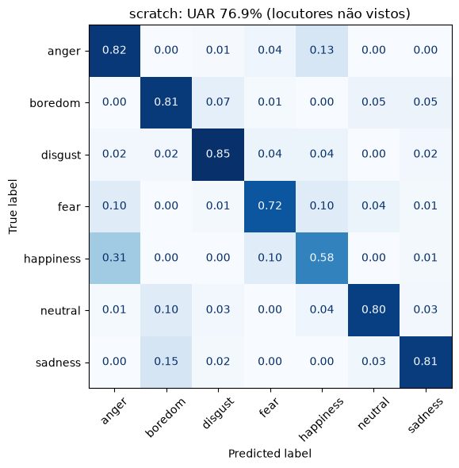
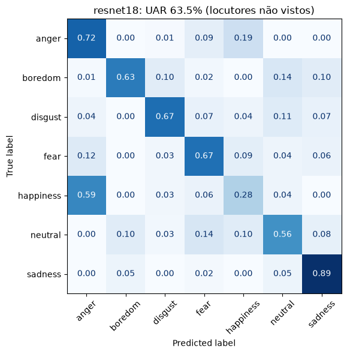

# Voice Emotion Recognition with CNNs

**Live app:** https://huggingface.co/spaces/jairvato99/voice-emotion-recognition  
**Repository:** https://github.com/JairVasquezT/voice-emotion-recognition  
**Course:** Apprentissage pour la robotique — Prof. Adriana Tapus - Prof. Juan José García Cárdenas  
**Team:** Jair Anderson VASQUEZ TORRES · Lucas Emanuel BARBOSA VASCONCELOS

Record your voice in the browser, see its log-mel spectrogram and let convolutional
neural networks guess the emotion. Two CNNs are compared: one **trained from scratch**
and one using **transfer learning** (ResNet-18 pretrained on ImageNet). All results are
measured on **speakers the models never heard during training**.

---

## 1. Data

| Corpus | Language | Clips | Speakers | Emotions | Status |
|---|---|---|---|---|---|
| [EmoDB](http://database.syntheticspeech.de/) | German | 535 | 10 (5 ♂, 5 ♀) | anger, boredom, disgust, fear, happiness, neutral, sadness | ✅ trained |
| [RAVDESS](https://zenodo.org/records/1188976) | English | 1,440 | 24 (12 ♂, 12 ♀) | neutral (+ calm), happy, sad, angry, fearful, disgust, surprised | ✅ trained (`entrenar_ravdess.py`) |

EmoDB is unbalanced (127 anger clips vs. 46 disgust), so the loss uses class weights and
the metric is the **unweighted average recall (UAR)**, i.e. the mean recall over classes
(chance level with 7 classes = 14.3 %).

The audio corpora are **not** included in this repository (license and size); download
them and place EmoDB's WAV files in `DB/archive/wav/`.

## 2. Method

### Features
1. Load at **16 kHz mono**, normalize by the peak amplitude.
2. Keep the **central 3 s** (zero-pad shorter clips).
3. **Log-mel spectrogram**: 25 ms windows (400 samples, FFT 512), 10 ms hop, **64 mel bands**
   → an image of **64 × 301**.
4. Standardize with the mean and standard deviation of the **training speakers only**.

### Models
| | Model 1 — CNN from scratch | Model 2 — Transfer learning |
|---|---|---|
| Architecture | 4 blocks: 2 × (3×3 conv + BatchNorm + ReLU) + 2×2 max-pool; 32 → 64 → 128 → 256 channels; global average pooling → dropout 0.3 → linear | ResNet-18 pretrained on ImageNet, spectrogram copied to 3 channels |
| Trainable parameters | ~1.2 M (all) | ~3.6 k (only the new classification layer; backbone and BatchNorm frozen) |

### Training
- Adam (lr 1e-3, weight decay 1e-4), cosine learning-rate schedule, 40 epochs, batch 32.
- Class-weighted cross-entropy.
- Data augmentation: random circular time shift (±0.3 s) + **SpecAugment** (one frequency mask of up to
  8 bands and one time mask of up to 30 frames).

### Evaluation: speaker-independent cross-validation
Splitting clips at random puts the same actor in training and test, so a network can
recognize the *person* instead of the *emotion*. We never let a speaker appear in both:
**5 folds, each one leaves out 1 male + 1 female speaker** for testing
(03+08, 10+09, 11+13, 12+14, 15+16). Every number below is on unseen voices.
The final models used by the app are then retrained on all 10 speakers.

## 3. Results (EmoDB, unseen speakers)

| Fold (test speakers) | CNN from scratch | ResNet-18 (transfer) |
|---|---|---|
| 1 (03, 08) | 75.3 % | 61.5 % |
| 2 (10, 09) | 81.8 % | 62.0 % |
| 3 (11, 13) | 74.8 % | 54.2 % |
| 4 (12, 14) | 78.5 % | 75.6 % |
| 5 (15, 16) | 74.3 % | 64.3 % |
| **Mean UAR ± std** | **76.9 % ± 2.8** | **63.5 % ± 6.9** |

Chance level: 14.3 %. Confusion matrices (row-normalized, all folds pooled):

| CNN from scratch | ResNet-18 |
|---|---|
|  |  |

**Observations**
- The small CNN trained from scratch beats the frozen ResNet-18 by ~13 points and is more
  stable across folds.
- The frozen ResNet-18 underfits: its training loss stays around 0.83 while the scratch
  CNN reaches 0.11. ImageNet features (edges, textures of photos) do not separate emotions
  in spectrograms well without fine-tuning.
- **Happiness is the hardest emotion.** The scratch CNN recognizes it only 58 % of the time
  and hears 31 % of happiness clips as anger; for the ResNet-18 it is worse (28 % correct,
  59 % predicted as anger).
- **Errors follow arousal (energy).** High-energy emotions are confused with each other
  (anger ↔ happiness, fear → anger/happiness, 10 % each), and so are low-energy ones
  (sadness → boredom 15 %, neutral → boredom 10 % in the scratch CNN).
- The scratch CNN is above 80 % recall on 5 of the 7 emotions (best: disgust, 85 %).
  The ResNet-18 is only better on sadness (89 % vs. 81 %).


## 3b. Results (RAVDESS, English, unseen speakers)

Same features, model and training as EmoDB (scratch CNN), run with
`python entrenar_ravdess.py --wav-dir DB/ravdess/wav` (RAVDESS speech zip unpacked in
`DB/ravdess/wav/`, ~25 min on a GTX 1050 Ti). "calm" is merged into "neutral", giving the same
7 classes as FER-2013. 6 folds of 4 actors (2 ♂ + 2 ♀) left out each time.

| Fold (test actors) | 01-04 | 05-08 | 09-12 | 13-16 | 17-20 | 21-24 | **Mean UAR ± std** |
|---|---|---|---|---|---|---|---|
| CNN from scratch | 73.5 % | 78.6 % | 61.6 % | 66.5 % | 70.4 % | 71.9 % | **70.4 % ± 5.3** |

Recall per class: angry 85 %, neutral 83 %, fearful 73 %, surprised 73 %, disgust 69 %,
happy 61 %, sad 48 % (sadness is mostly heard as neutral, 24 %). Confusion matrix:
`results/ravdess/scratch.png`. The final model (all 24 actors) is `models/ravdess/scratch.pt`.

## 4. Web app

The app is a **static web page**: the trained PyTorch models are exported to **ONNX** and
run **inside the user's browser** with ONNX Runtime Web, so no server is needed and the
voice is never uploaded.

- Record from the microphone (with a live spectrogram) or upload a file.
- Shows the trimmed waveform, the 3 s window analyzed and the exact 64 × 301 log-mel
  spectrogram the CNN receives.
- Choose which models to compare (grouped by training corpus); each one shows the
  probability of every emotion and its cross-validated UAR.
- Interface in English, French and Spanish.

The preprocessing (silence trimming, peak normalization, STFT, mel filterbank, dB
conversion) was ported to JavaScript (`web/dsp.js`). `export_onnx.py` checks that the
browser version matches librosa (max. error < 0.05 dB) and that each ONNX model gives the
same output as PyTorch.

## 5. Repository structure

```
EmotionDetection.ipynb   feature extraction, cross-validation, final training
export_onnx.py           .pt → web/models/*.onnx + manifest.json (with checks)
app.py                   optional local version of the demo (Gradio)
models/                  trained PyTorch checkpoints (.pt)
results/                 metrics.json, scratch.png, resnet18.png (confusion matrices)
web/                     the static web app (what is deployed)
  index.html, app.js, dsp.js
  models/                ONNX models + manifest.json
```

## 6. How to reproduce

```bash
python3 -m venv .venv && source .venv/bin/activate
pip install -r requirements.txt
# 1. put EmoDB in DB/archive/wav/ and run EmotionDetection.ipynb
# 2. export the models for the browser
python export_onnx.py
# 3. try the app locally (the microphone works on localhost)
cd web && python -m http.server 8000     # open http://localhost:8000
```

To deploy, upload the **contents of `web/`** to a static host (Hugging Face Static Space,
GitHub Pages, …).

## 7. Limitations

- Each model is trained on a single **acted** corpus: actors exaggerate emotions and record
  in a studio. Spontaneous speech, other languages and other microphones are harder, so
  real-world accuracy is lower than the UAR reported here.
- EmoDB has only 10 speakers, so each fold tests on 2 people and results vary between folds.
- Only the central 3 seconds of each recording are analyzed.

## 8. Who did what

| Member | Contribution |
|---|---|
| Lucas Emanuel BARBOSA VASCONCELOS | Data preparation and log-mel features (EmoDB), design and training of both CNNs (from scratch and ResNet-18 transfer learning), speaker-independent cross-validation, results and confusion matrices; English models (RAVDESS). |
| Jair Anderson VASQUEZ TORRES | Web application (recording, live spectrogram, waveform and log-mel display, model comparison, EN/FR/ES interface), port of the preprocessing to JavaScript, export of the models to ONNX with verification, deployment on Hugging Face, repository and README. |

## References

- Course material: J. J. García Cárdenas, "Can a machine hear how you feel?", 2026.
